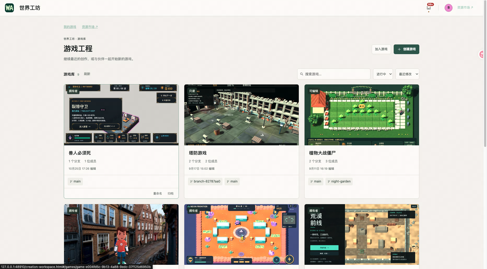
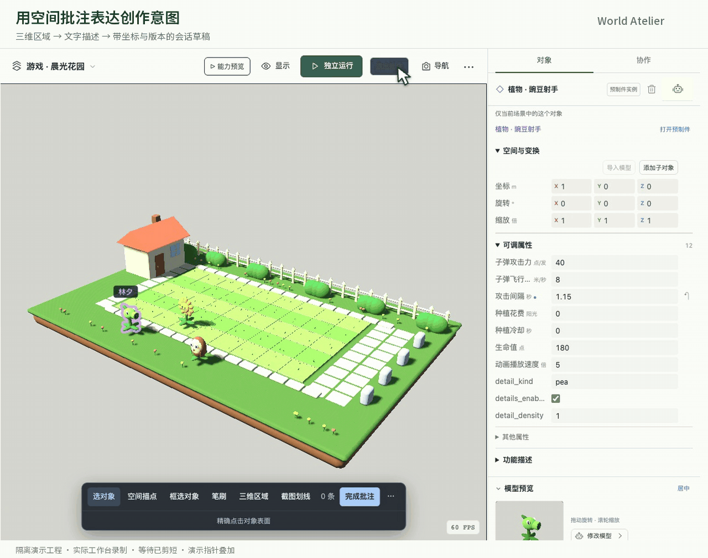
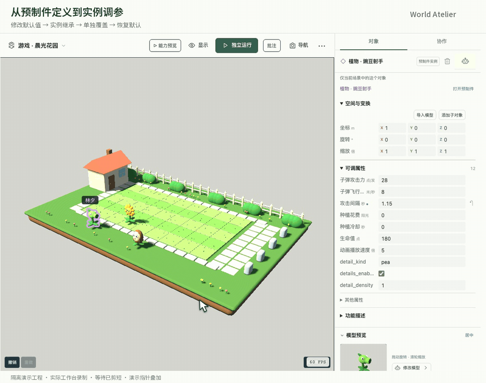
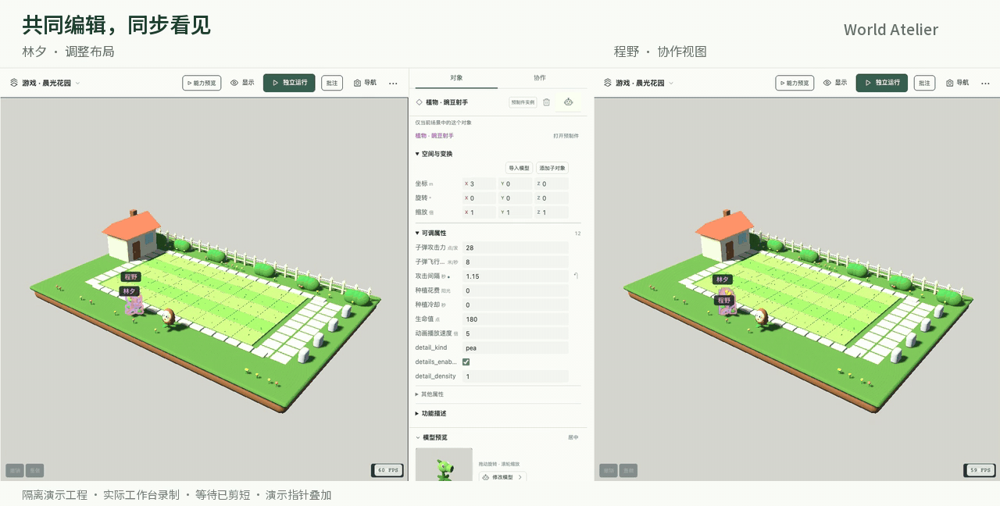

<p align="center">
  
</p>

<h1 align="center">世界工坊 · World Atelier</h1>

<p align="center">
  <strong>与 AI 和伙伴一起，把游戏持续打磨下去。</strong><br />
  对话创作，可视化编辑，在浏览器里运行真实 Godot 游戏。
</p>

<p align="center">
  <a href="#创作体验">创作体验</a> ·
  <a href="#本地运行">本地运行</a> ·
  <a href="#文档与开发">技术文档</a>
</p>



<p align="center"><sub>现有工作区的游戏库。每个游戏都有自己的分支、协作者与创作记录。</sub></p>

世界工坊是一个 **AI 协作游戏创作工作台**。你可以从一个想法开始，让 Agent 制作场景、素材与玩法；也可以调整对象参数、替换素材、指出试玩中的问题，与伙伴继续完善已有作品。

项目关注游戏的第二次、第二十次修改：创作者怎样把感受表达清楚，Agent 怎样理解现场，已有成果怎样在持续迭代中保留下来。

## 创作体验

### 从试玩反馈到实际修改

“我按了两次交互，门还是没打开。”工作台默认在当前窗口保留最近 **60 秒**的操作记录与关键画面。通过“指出这里”进入观察，点选或框选关注区域，发送反馈时一起交给 Agent。编辑场景时，也能用空间点、区域或截图批注表达具体意图。

附件固定当时的对象、坐标和版本。Agent 读取观察材料、查询当前源稿，再修改实际工程；后续移动对象或切换分支，都不会改写旧反馈。

**试玩 → 指出问题 → Agent 带上下文修改 → 重新试玩**



### 预制件复用与可视化调参

角色、建筑、机关和玩法系统可以组织为独立预制件，随时查找、打开和复用。可调属性连接真实的 Godot 属性，数值、开关、枚举和颜色都能在面板中编辑。

调整难度可以先改参数，修改机关可以聚焦该预制件，增加新行为再交给 Agent。修改定义时，未覆盖的属性跟随更新，单独调整过的实例值保留，并支持恢复默认。模型、贴图和脚本随工程一起版本化，逐步积累为下一轮创作的基础。



### 共同编辑，自由探索不同方向

协作者可以在同一分支编辑场景，看到彼此的选中对象和编辑状态。手动操作与 Agent 修改通过相同的中央事务保存，遵守一致的权限和版本约束。尝试另一种布局或玩法时，可以分出新分支，独立创作，再预览差异、处理冲突并合回主干。

**编辑器 Play 是每个窗口独立的一局。** 暂停只暂停当前试玩，自由相机仍可观察；伙伴可以继续编辑或试玩。重新开始从选定源版本的初始状态启动，内容合并与试玩进度分别管理。



### 持续积累的创作上下文

每位协作者可以在每个分支保留多个长期 Agent 会话，积累讨论、附件和修改记录。切换方向时，可以把选定历史与观察带到新分支，在独立会话里继续开发。

用 `@` 引用场景对象，`@@` 引用预制件，`$$` 查找游戏知识，就能围绕“这个敌人”“这段规则”“刚才的操作”继续讨论。描述、参数与知识跟随源版本，Agent 按需读取实际定义和实现。

## 核心设计

技术栈为 **Node.js、SQLite、原生 Web 界面与 Godot 4.6**，Agent 执行接入 Codex App Server。中央服务管理工程、权限、分支和会话，浏览器提供编辑与试玩体验。

- **一份原生工程。** 场景、资源、脚本和资产保留 Godot 原生文件；Web、Agent 与离线修改汇入同一版本化源稿。预制件继承交给引擎解释，Web 不认识的属性也保留。
- **一致的运行入口。** 编辑器 Play、独立 Web 和 Agent 固定测试工程共用装配与启动逻辑，减少编辑和运行之间的偏差。
- **明确的交付过程。** 保存产生源版本，构建固定工程与工具链，显式发布才更新公共试玩版本。创作者可以继续修改，玩家进入确定的已发布构建。
- **分开的运行权限。** 作者游戏在独立浏览器来源中运行，通过有限消息接口提供观察与交互，保持游戏与工作台创作、管理 API 的权限边界。

原生离线工作区支持基于固定版本修改、同步和冲突处理。实现细节见[原生框架](docs/NATIVE-FRAMEWORK-UPGRADE.md)、[统一游戏工程](docs/UNIFIED-GAME-RUNTIME.md)与[离线往返](docs/NATIVE-MERGE-OFFLINE-INTEGRATION.md)。

## 本地运行

当前开发环境为 **macOS**。首次运行需要：

- **Node.js 24+**。
- **Godot 4.6 stable**，以及匹配的 Web 导出模板。
- **已登录的 Codex CLI**，Agent 创作通过兼容的 App Server 执行，见 [Codex 集成](docs/CODEX-INTEGRATION.md)。

```bash
git clone https://github.com/BruceCheng1995/WorldAtelier.git
cd WorldAtelier
npm install
npm run build:preview
npm start
```

打开 **[世界工坊工作台](http://127.0.0.1:48910/creation-workspace.html)**。

`build:preview` 准备编辑视口，具体游戏在 Play 时构建。界面、创作 API、Agent 会话与 Godot Web 共用 `48910` 服务；再次启动会复用已经运行的本项目服务。

<details>
<summary>工具路径与首次使用</summary>

- 默认 Godot 路径为 `/Applications/Godot.app/Contents/MacOS/Godot`，Codex 为 `/opt/homebrew/bin/codex`。路径不同时，在构建或启动前设置 `GODOT_BIN`、`CODEX_BIN`。
- 本地 HTTP 适配固定校验 `4.6.stable.official.89cea1439` 与官方导出模板。用 `codex login status` 检查服务账户的登录；升级 CLI 后需核对 App Server 兼容性。
- 空数据库的首个账号可创建第一个游戏。其他新账号默认可浏览、试玩，获得编辑授权后可创作并启动 Agent。
- 默认开放局域网连接与注册；仅本机使用时设置 `WORLD_ATELIER_LAN=0`。数据保存在 `.local/model-preview/`，截图中的游戏不随仓库分发。

完整配置与后台运行见[本机开发指南](docs/LOCAL-DEVELOPMENT.md)。

</details>

## 当前进展

项目持续开发中，当前面向本机和局域网使用，已接入真实 Agent、Godot Web、原生源稿编辑与协作流程。[独立验证记录](docs/CREATION-NEXT-WAVE-VALIDATION-2026-10-23.md)涵盖试玩反馈到 Agent 修复、重开后的行为检查、跨分支续聊、合并与离线往返，按服务、引擎、浏览器和 Agent 分别记录结果。

接下来优先缩短编辑到 Play 的等待，完善长期创作体验。公网托管与跨平台发行仍待探索，现有验证不代表大规模部署已经完成。

## 文档与开发

- [创作工作台](docs/CREATION-WORKSPACE.md)：场景、预制件、协作与会话交互。
- [试玩上下文](docs/CREATION-NEXT-WAVE-2026-10-23.md) · [视口批注](docs/VIEWPORT-ANNOTATIONS.md)：把操作、画面和空间意图交给 Agent。
- [Agent 执行环境](docs/AGENT-ENVIRONMENTS.md) · [资产工作流](docs/AGENT-ASSET-WORKFLOW.md)：固定工程、开发工具与素材处理。
- [工程导航](PROJECT.md) · [开发约定](AGENTS.md)：架构、实现与验证入口。

```bash
npm test                       # 创作模块的单元与集成检查
npm run test:creation:engine    # 真实 Godot 检查
npm run test:legacy             # 历史协议回归
```

按改动选择测试，浏览器交互与游戏体验另行验证；测试数据和服务与正式工作区隔离。
