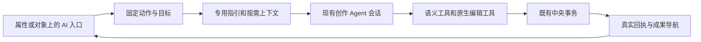

# AI 创作入口、专用工具与任务上下文设计

2026-09-09。状态：`AI 添加属性` 首个试点已实现，其余动作仍为设计提案。依据植物大战僵尸的真实会话、工具事件及当前代码；不将历史 Agent 自述的测试结果当成本轮玩法验证。试点范围、实际接口和验证见本文末尾。

建议在原工作台内建立“入口明确的 AI 创作动作”：入口提供目标和作用范围，Agent 负责理解需求与编写非标准实现，工具负责可重复、可校验的编辑操作。第一阶段使用同一执行器和持久会话机制，按动作加载专用上下文与工具集合；无需先建立多套独立 Agent 服务。

## 1. 样本与实际发现

本轮只读查询正式 `creation.sqlite` 中的 `creator_session`、`creator_message`、`creator_run` 和 `events`。项目为 `game-cf0039b0-7916-48be-b19a-aaaa4b236696`，分支为 `main`。数据库中的会话事件使用 `session:<session_id>` 作为事件作用域。

2026-09-09 14:30（上海）读取的当前源为 `src-084487137b46f1ee36448bf54c5bb30ac80060bf920662efb62190adbc25b4e1`，schema 为 `creation-native-1`。下列六个属性任务发生在旧源框架，适合分析操作模式和用户需求；其旧 `patch_object`、行为数组和实例同步方式不能作为新实现契约。

| 真实任务 | 记录中的实际工作 | 设计启示 |
| --- | --- | --- |
| 豌豆：子弹攻击力、飞行速度 | 伤害来自花园规则，速度写死为 8；Agent 补充预制件到战斗逻辑的读取链路，再公开属性 | “公开已有字段”与“实现参数化后公开”是两个分支 |
| 向日葵：产出间隔、数量 | “金币”与“阳光”有含义差异；数量原本写死为 25；保存时合并豌豆任务对同一脚本的修改 | 带入项目术语和消费位置；按真实文件依赖处理并发 |
| 坚果：防御力 | 实际只有生命值，Agent 解释为“防御力（耐久）”并接入种植逻辑 | 不应把不存在的护甲机制包装成已经存在的字段 |
| 三个僵尸：速度、血量 | 三个预制件配置都需接入战斗逻辑，随后分别读取、公开、读回 | 支持多目标同类动作和批量属性操作 |
| 豌豆：攻击间隔 | 发射计时有参数，但未读取预制件可调值；涉及场景覆盖和与波次控制脚本合并 | 入口需明确默认值、实例覆盖和生效时间 |
| 全部预制件：适当公开属性 | Agent 当时检查 8 个预制件，报告新增 11 项；一次提交因“生命值不符合调整步长”失败 | 工具应处理元数据约束、保留原值及批量结果；不要为凑数量暴露无意义参数 |

还有三条很有价值的记录：

- 用户在“游戏控制器”任务完成后追问“在哪里，是个预制件吗”。结果需要直接定位新资源，并解释“系统预制件、无模型、如何被游戏使用”。
- “将封面拆成独立场景”以及 Boss 场景任务出现设计分类不合法的问题；拆场景还涉及旧兼容脚本哈希同步。资源登记和已知依赖维护适合工具处理。
- Boss 任务反复等待中央保存，最后一次会话答复仍区分本地完成与中央修复未确认。保存作业需要可查询身份与明确状态，不能把持续聊天等待当作恢复机制。这里描述的是该历史任务记录，不判断当前 Boss 版本是否仍有问题。

### 工具事件计数

按 `serverRequest / item/tool/call` 统计宿主工具调用，按去重后的 `item/completed` 统计命令。包括失败和重试；不把 started/completed 双算，不将命令等同于模型回合或 token 消耗。

| 属性任务 | 宿主工具调用 | 其中 world_read + semantic_read | 命令执行 |
| --- | ---: | ---: | ---: |
| 豌豆伤害、速度 | 11 | 5 | 10 |
| 向日葵产出 | 12 | 7 | 18 |
| 坚果耐久 | 15 | 8 | 7 |
| 三个僵尸 | 18 | 12 | 8 |
| 豌豆攻击间隔 | 19 | 12 | 16 |
| 全部预制件 | 18 | 12 | 7 |
| 合计 | 93 | 56 | 66 |

这些调用包含必要的写前重读和自选测试，不应全部消除。优化空间在于减少重复发现、全量材料返回、平台格式修复和多资源重复操作；目前没有优化后的对照数据，不能承诺节省比例。

## 2. 已有基础与缺口

已核对原入口的监听进程、工作目录和路由：48910 → `services/preview/server.mjs` → `apps/creation-workspace/index.html`。本轮内置浏览器到达未登录页面，因此以下交互判断依据源码与会话记录，未声称完成登录后的现场交互验收。

| 当前基础 | 可以复用 | 需要补齐 |
| --- | --- | --- |
| `requestSemanticAgent()` | 强制新建会话、固定对象/预制件附件、预填需求、切换保护 | 结构化动作记录、动作类型与范围、专用指引 |
| 检查器“修改功能 / 控制属性需求” | 从定义发起真实会话 | 按属性区、属性行、模型区提供更贴近目标的入口；当前实例不显示这组入口 |
| `agentEntry()` | 打开已有会话抽屉 | 当前模型/场景入口只修改通用 placeholder；需要固定对象、新建任务与专用材料 |
| `createResource()` | 创建空的场景/预制件，选择三维、二维或界面 | AI 创建带内容的资源，并在完成后打开成果 |
| `CreationEnvironments.context()` | 固定运行上下文、源版本、附件、设计索引、完整工程 | 按动作生成首屏摘要和按需材料，不让 Agent 反复翻全工程 |
| `CREATION_TOOLS` 与动态工具路由 | 现有语义工具、原生事务、租约、幂等回执 | 按动作选工具、批量语义操作、结构化结果 |

当前所有创作会话在绑定执行器时传同一份 `CREATION_TOOLS`。目标附件帮助理解任务，但没有形成对象级写权限。两项优化要分别交付、分别描述。

## 3. 用户入口设计

保留已有直接编辑控件；当用户需要生成内容、补齐逻辑、解释意图或协调多个属性时提供 AI 动作。单纯改数值、选资源、旋转对象继续使用原控件。

| 位置 | 建议按钮 | 自动带入 | 用户主要补充 |
| --- | --- | --- | --- |
| 预制件目录 | AI 创建 | 当前项目/分支、维度、相关设计和可用资产 | 想创建什么、它应当怎样工作 |
| 对象菜单 | AI 创建预制件 | 选中对象及子树、引用关系、现有覆盖 | 抽取现有对象，或基于它制作一个新变体 |
| 可调属性区 | AI 添加属性 | 目标定义、已有属性及消费依赖 | 希望调整的能力，例如攻击间隔 |
| 已有属性行菜单 | AI 修改 | 属性 ID、实际值、单位、绑定、覆盖范围 | 改语义或控制方式，例如随波次递减 |
| 模型区 | AI 修改模型；无模型时 AI 创建 | 当前模型、实际预览、尺寸、相机、动画/挂点及来源 | 外观变化，例如加大炮口、改成冰霜风格 |
| 多选对象 | AI 批量调整 | 全部稳定目标及差异 | 同类目标，例如三个僵尸都公开速度和血量 |

“AI 创建”可作为统一入口家族，但按钮处尽量带对象名词；已有内容用“AI 修改”，避免用户误以为要创建另一个对象。

### 从点击到完成

1. 点击时捕获目标和版本，展开轻量需求输入。默认只需一句话，显示“对象名 · 动作 · 作用范围”；高级参数收起。
2. 提供两三个来自当前对象的示例，例如“攻击间隔”“弹道效果”，允许自由输入。点入口本身不启动未知任务；提交需求就是开始执行。
3. 提交时沿用现有新会话机制，保存动作和不可变附件。若入口提前创建会话，未发送时保留草稿，不生成空运行记录。
4. 在原聊天抽屉继续对话，标题采用“豌豆射手 · 增加攻击间隔”。关闭抽屉可继续编辑；回看任务能定位原目标。
5. 结果显示实际变更与入口，例如“已添加 1 项属性 · 打开属性”；模型任务显示真实前后预览；预制件任务提供“打开预制件”和“放入当前场景”。放入场景是另一个明确动作。
6. 已授权、目标清楚的修改使用原事务直接保存。取消只取消未完成的工作；已提交内容保留回执，需要撤销时生成有版本保护的逆事务。

新动作默认新会话；在结果中点击“继续调整”回到原会话。任务类型记录在每次动作/执行上，会话的初始类型只用于导航。后续用户提出另一类工作时创建新的动作版本，不永久限制整段对话。

### 作用范围的默认值

- 定义编辑器：修改预制件定义；未覆盖实例遵循 Godot 继承。
- 场景实例：已有值的 AI 调整默认仅此实例。若要新增公开属性，属性契约属于定义，应直接标明“为来源预制件增加属性”；需要实例独有的逻辑时明确制作变体，不伪造实例级设计元数据。
- 模型资产：显示“修改定义外观”或“仅替换此实例外观”。共享 Material/Mesh 等子资源必须检查实际共享范围；实例独有要求创建适当的新资源引用。
- 运行中观察对象：固定实际关卡、版本和来源地址。不能定位源对象时保留观察供讨论，不按名字猜测目标，也不把本局状态当成源稿。

含义不同且会改变玩法的歧义需要一次明确选择，例如“现有阳光产出”与“新增商店金币产出”、“生命值”与“护甲减伤”。读取代码和整理候选可继续，依赖该选择的修改不擅自执行。

## 4. 架构：共享执行器，组合任务配置



建议四个概念：

- **Action**：用户这一次想做什么、从哪里发起、作用于谁。
- **Recipe**：处理这一类任务的步骤、默认策略、常见歧义、失败恢复和结果格式。
- **Context**：该固定目标的真实数据、源码定位和依赖，按需读取。
- **Tools**：确定性检查与编辑操作；复用中央事务保存原生文件和元数据。

Recipe 相当于产品内可版本化的任务指引。以后某类任务确实需要独立工具链、资源预算或调度环境，再拆成专用 worker；“按钮不同”本身不足以要求独立 Agent 服务。

### 动作记录示意

以下为拟新增数据，不是现有 API：

```json
{
  "action_type": "expose_properties",
  "recipe_version": "1",
  "entrypoint": "inspector.properties",
  "target": {
    "resource_id": "prefab-pea",
    "scope": "definition"
  },
  "intent": "公开攻击间隔",
  "preserve_existing_values": true,
  "expected_outputs": ["exposed_properties", "result_targets"]
}
```

服务端补全并固定 `action_id`、项目/分支/用户/会话、捕获版本、完整对象地址及属性版本、运行租约和能力集合。引用区分 `target`、`reference`、`placement_anchor`；示例对象不因出现在上下文里就成为修改目标。

点击快照解释用户当时看见什么；执行时重读当前源解释现在能修改什么。两者不能合并成一个随 head 移动的“最新上下文”。切换页面选择不会改变后台动作目标。

## 5. 专用上下文如何组织

共同底座保持精简：当前原生源规则、事务要求、身份和权限、完整地址、统一运行入口。各 Recipe 只添加相关材料。

| 层次 | 内容 | 加载方式 |
| --- | --- | --- |
| 任务摘要 | 意图、目标、范围、默认值、期望结果、已知歧义 | 启动直接提供 |
| 对象材料 | 原生节点、已公开属性、模型信息、实际继承值与覆盖状态 | 首次目标读取 |
| 一跳依赖 | 实际挂载脚本、引用资源、实例使用位置、已知玩法消费入口 | 按任务筛选，返回位置和摘要 |
| 深层材料 | 完整脚本、相关游戏知识、其他场景、原始模型文件 | Agent 请求时读取 |
| 完整工程 | 固定全部原生文件和依赖 | 需要编辑/运行时用 workspace_prepare |

对于豌豆参数任务，首屏应说明“编辑豌豆定义；当前攻击间隔 1.15 秒；战斗消费入口在花园规则；原值保留；重新试玩读取”。其中源码位置必须从固定版本查得，不能硬编码这次 PvZ 的路径到通用 Recipe。

消费位置分为“明确资源引用”“搜索得到的候选”“运行观察证据”。任意 GDScript 的数据流不一定能静态完整追踪；不知道时明确返回未知，并允许继续检索。`binding_valid` 只能表达绑定和数值合法，不能表达玩法效果已证明。

专用 context 可以缩小阅读范围，完整可提交工程仍必须保留。当前整工程提交会把基线存在而副本缺失的文件视为删除；绝不能把只包含选中预制件的材料目录交给 `submit_native_workspace`。

## 6. 哪些能力封装为工具

原则是“规则稳定且可校验的步骤做工具，需要理解和创造的步骤留给 Agent”。以下名称是设计建议，落地时可作为现有工具的扩展操作。

| 拟议能力 | 工具处理 | Agent 处理 |
| --- | --- | --- |
| `authoring_context.read` | 按动作返回目标、当前版本、绑定、继承、资源使用位置及源码定位；批量读取 | 理解需求、选择需要深入的依赖 |
| `prefab.create` | 创建真实原生场景、稳定 ID、目录登记、二维/三维/界面根类型及真实结果地址 | 决定结构、编写玩法、制作内容 |
| `properties.expose` | 按属性稳定 ID 批量新增/更新元数据、校验绑定/类型/范围/步长、避免重复覆盖整个 design | 找到消费链路；已有实现不足时改脚本；决定名称与合理范围 |
| `model.replace` | 检查候选资源与目标、生成真实引用变更、计算影响范围、保存新资产身份 | 理解外观、用可用建模工具制作候选、评估视觉结果 |
| 原有事务 + 作业查询 | 原子提交依赖变更，返回提交或持久作业 ID，幂等查询最终状态 | 冲突时理解两方意图并合并；必要时调整实现 |

不需要同时新增第二套 `change_commit` 权威。便捷操作最终进入原 `world_apply` / 原生事务；局部标量继续复用 `semantic_apply`。

### 公开属性的两条执行路径

**已有真实参数**：读取 → 对齐语义 → 补充元数据 → 事务保存 → 读回属性与成果地址。原生 `@export` 已能自动发现，应优先补全名称/单位等，不复制第二套属性。

**尚未参数化或未被消费**：读取 → 找到常量/配置及消费代码 → Agent 实现参数化和连接 → 批量生成绑定元数据 → 将逻辑、资源和元数据作为一致变更保存 → 读回。对于迁移内容，已知兼容脚本哈希等引用维护可工具化；任意业务数据流仍需 Agent 判断。

工具在候选阶段检查所有相关当前值都满足范围和步长，避免为满足 UI 范围擅自改变游戏原值。若有场景实例超过拟议范围，返回具体对象与原因。增量元数据按稳定 ID 合并，保留未改属性、关系和描述。

玩法测试由 Agent 自行选择：可针对伤害、间隔、产出等做有辨识力的检查；没有测试时如实记录。工具不能仅靠属性存在就输出“调节一定生效”。不增加自动验证 Agent、会话顶部验收面板或保存审批门禁，保留 `/goal` 原有能力。

### 修改模型的特殊上下文

带入真实模型预览、实际游戏相机、包围盒/单位/朝向、材质、骨骼动画、挂点与碰撞引用。存在可追溯 `.blend` 或生成脚本时优先修改来源；只有 GLB 时说明可用编辑能力，不能承诺恢复原始参数化工程。

默认外观任务保留玩法和稳定对象身份；需要改碰撞或挂点时说明具体关联变化。先制作新候选，成功后通过新引用替换；生成失败不会清空原模型。骨骼/动画不兼容、二维对象误用三维模型等问题必须返回实际原因。显示候选仅代表可预览，尚未提交的候选不能标为已保存。

## 7. 执行、并发与恢复

- **工具集合**：新动作可少展示无关工具，例如普通属性动作无需共享世界发布工具；保持按需读取和必要文件编辑能力。仅把工具从提示中隐藏，不构成权限控制。
- **范围约束**：Recipe 表达默认意图；需要“仅此模型”这样的强保证时，服务端同时约束语义操作、源码 diff、提交路径和依赖范围。允许为完成既定目标修改已识别的消费代码；无关规则变化应被排除。权限仍由原项目成员与执行租约决定。
- **能力扩展**：目标所需的一跳依赖可自动读取和纳入候选；超出用户意图的玩法变化或扩大修改范围应说明具体对象和用途。不能因为选中对象 A 就自动获得修改整个项目的产品承诺。
- **并发**：豌豆和向日葵可以并行分析、制作候选；都写花园脚本时必须按当前哈希重读与合并。工具封装不能取消写前版本检查。
- **原子性**：一次完整动作涉及脚本、场景与属性元数据时共同提交，避免先公开控件再等待绑定修复。若长任务分批提交，每批有独立回执和用户可见范围。
- **取消**：旧运行的异步生成/提交不能借新租约继续写；恢复要先查询原事务结果。相同请求 ID、相同内容重试返回同一结果，内容已变则使用新的逻辑事务。
- **长保存**：建议返回持久 `job_id` 和阶段，例如排队、构建索引、提交、失败、完成；状态必须来自服务。读回相关源身份后才能显示保存完成，不循环让 Agent 发送“仍在等待”。
- **旧会话**：保留原 thread、cwd、消息和附件；普通旧会话不被追溯改成专用动作。运行中的工具表不偷偷换版，后续执行按兼容策略加载固定 Recipe。

状态展示沿用现有输入区域和任务记录：正在处理、需要你的输入、保存处理中、已保存、失败/已取消。Agent 的效果判断和自选测试结果是附加事实，不替代保存回执。源提交、可用构建、公共试玩发行继续分开。

## 8. 结果协议与第一阶段范围

每个动作应产生结构化结果：`action_id`、实际源提交/作业身份、创建或修改的资源/属性 ID、作用范围、变更前后摘要、可打开成果、可用撤销信息、实际检查证据和未检查项。会话正文用于解释，前端导航不从正文猜资源名称。

建议次序：

1. **先做 AI 添加属性。** 接通新动作记录、专用 context、真实结果导航；利用现有语义与原生工具完成闭环。优先覆盖已有参数补说明、需要补消费链路、多目标三个僵尸三类。
2. **再封装批量属性操作和预制件创建。** 解决完整 design 覆盖、范围/步长、根类型/分类等稳定问题；创建后直接打开独立预制件。系统预制件也要可发现，并说明使用方式。
3. **再做 AI 修改模型。** 复用真实资源预览，明确替换与新建的差别，再补充模型来源、候选、资源兼容性和引用影响分析。
4. **最后按数据决定是否拆 worker。** 建模工具链确实需要独立环境时拆建模 worker；不要为每个名词维护一套聊天、权限、存储和提交系统。

试点评估使用固定输入副本与同等模型/工具链，对照普通入口和专用入口。记录首次有效修改耗时、用户补充次数、全量读取量、平台格式失败次数、冲突恢复、结果能否打开，以及实际功能完成率。一次样本不能推出稳定性能结论。

有意义的实现验证包括：旧值保持；参数真正影响玩法；定义/实例/恢复正确；批量读写不漏目标；双任务同脚本修改不丢失；取消后晚提交拒绝；完整工程未知文件保留；真实结果点击能打开；未保存作业不显示完成。产品中不因此新建自动验收工作流。

## 9. 证据与代码入口

会话 ID 用于本机只读复查；不包含凭据，不将私人会话内容写入游戏共享知识。

| 样本 | 会话 ID |
| --- | --- |
| 豌豆伤害、速度 | `session-d4dcbb67-9805-4096-8a18-a83b4972691e` |
| 向日葵产出 | `session-e2b5bd78-1810-4413-886e-ee2b0a7a89bc` |
| 坚果耐久 | `session-f1d8e1c8-b507-45eb-9384-e56c2883fb3a` |
| 三个僵尸 | `session-1f13418b-8a8a-49dd-a4b4-aba92355b60d` |
| 豌豆攻击间隔 | `session-faf68bd1-4522-44eb-a329-2db714179283` |
| 全部预制件 | `session-540df424-974c-42d9-b22d-d3ea98b00356` |
| 游戏控制器 | `session-3b1936d1-415d-444d-83ea-55b8f4f6533f` |
| 独立封面 | `session-5c2632ad-038a-4a51-83ee-6969f68699c5` |
| Boss 场景 | `session-67987e75-9dd7-46f5-8da9-e09d68912896` |

主要实现定位：

- [现有语义 Agent 入口](../apps/creation-workspace/workspace.js)：`requestSemanticAgent`、`agentEntry`、`createResource`。
- [检查器](../apps/creation-workspace/semantic-inspector.js)：`semantic-quick-actions`、可调属性与定义/实例展示。
- [工具与执行](../services/creation/agent-runs.mjs)：`CREATION_TOOLS`、`bindOnce`、`assertRun`、`dynamic`。
- [固定上下文](../services/creation/environments.mjs)：`session`、`context`、`prepareOnce`。
- [原生属性](../services/creation/native-semantic.mjs)：`nativeExposedProperties`、`nativeSemanticDetail`、`nativeSemanticOperations`。
- [原生工程提交](../services/creation/native-agent-workspace.mjs)：`nativeSemanticAuthoringGuide`、`expandNativeWorkspaceApply`。
- [原生事务](../services/creation/native-transactions.mjs)与[完整工程装配](../services/creation/project-snapshot.mjs)。

原生契约以 [NATIVE-FRAMEWORK-UPGRADE.md](NATIVE-FRAMEWORK-UPGRADE.md)、[CREATION-PROTOCOL.md](CREATION-PROTOCOL.md) 和 [UNIFIED-GAME-RUNTIME.md](UNIFIED-GAME-RUNTIME.md) 为依据。旧实例参数修复见 [PVZ-INSTANCE-PARAMETERS.md](PVZ-INSTANCE-PARAMETERS.md)，仅用作问题来源，不复用其旧存储语义。

## 10. 已实施试点：AI 添加属性

入口位于原生预制件定义的“可调属性”标题旁。点击后创建独立持久会话，固定项目、分支、定义 ID、来源版本和不可变预制件附件；输入框保持为空，显示具体目标和需求示例。提交自然语言需求后才启动 Agent。旧会话继续使用原工具集合，原生实例值仍可直接编辑。

实现使用现有执行器和事务，没有新服务或独立 Agent 后端：

- 会话创建接口接受 `authoring_action: {type: "expose_properties", resource_id, revision, expected_version}`。服务端检查编辑权限、当前 head、原生预制件类型和版本，每次 run 保存动作快照。
- [authoring-actions.mjs](../services/creation/authoring-actions.mjs) 提供 recipe 1、工具配置与真实结果归属。`authoring_context` 返回目标、当前属性、节点、使用资源和有数量/大小限制的源码候选；候选是依赖和文本匹配，不代表完整数据流分析。
- `properties_expose` 接受事务 ID、版本和批量属性元数据，按稳定属性 ID 合并。检查绑定、存储类型、值、范围/步长和已有实例覆盖；通过原中央事务提交，保留未知文件及未改元数据。`prepare_only` 可返回未保存的操作以便与源修改一起提交。
- 已有参数直接公开；硬编码或未消费的参数仍由 Agent 在完整工作副本中修改真实实现，再通过 `world_apply` 原子提交。仍提供 `game_validate`、`workspace_test` 供 Agent 自选，不新增自动验证流程。
- 保存卡从该 run 的实际源提交和各提交父版本推导，排除其他 run 和无关资源的变化。`binding_valid` 不表示玩法通过；结果只报告源保存。点击“打开属性”回到当前分支的目标定义，展开属性区并聚焦对应字段。

试点的目标在会话内保持固定，换目标时从另一个定义重新发起。工具集合是任务引导，不是对象级文件权限沙箱。多目标批量入口、预制件 AI 创建、模型修改、独立建模 worker 和同条件性能 A/B 对照尚未实施。

### 实际验证

使用 48921、独立 SQLite 和原生工程测试；正式植物大战僵尸源稿未被用作测试写入目标。真实浏览器与 GPT-6-Astra/medium 执行了：入口 → 新会话 → 自然语言需求 → `authoring_context` → 两次定点源码读取 → `properties_expose` → 上下文回读 → 保存卡 → 打开并聚焦“攻击间隔”。共 5 次宿主工具调用，界面还计入 2 次命令执行，共显示 7 项；任务范围比历史 PvZ 实现任务小，不能据此声称调用或耗时节省比例。

真实执行 `run-d89435e0-d27f-4378-9102-2bff54611dc5` 保存为 `src-1175f88c5636e6b6afe3563d1bcd0fc312dda3b6fb279cf45c51a8cbbb97f6e2`。只变更 `.atelier/catalog.json`；原生场景、脚本和未知文件字节不变。攻击间隔显示中文名称，单位秒、范围 0.1–10、步长 0.05；定义及继承实例保留 1.15，覆盖实例保留 2.0。Agent 确认脚本消费位置并回读，明确未做玩法试玩。

独立测试位于 [ai-property-action.test.mjs](../tests/creation/ai-property-action.test.mjs)，包含真实 Godot 索引、取消/租约、并发版本、幂等、批量失败无部分提交、未知文件保留、结果归属和原生继承消费验证。测试中的 run 身份是明确标注的 fixture，不冒充真实 Agent；与上述实际会话证据分开保存。

本机证据目录：`.local/creation-verification/ai-property-action-integration/`（真实会话、源回读与回归日志）；`.local/creation-verification/ai-property-action/`（独立测试与 Godot 报告）。测试数据与登录信息不进入 Git。

验证汇总：相关回归 89/89 通过；独立侧累计 10/10 个检查场景通过，最后针对节点路径修正复测通过。正式 48910 已受控重启并返回 `ai_property_actions: 1`；重启前后 5 个分支 head 相同，记录数量未减少，`automatic_verification` 仍为 `false`。刷新原工作台后可从原生预制件的属性区使用入口。
