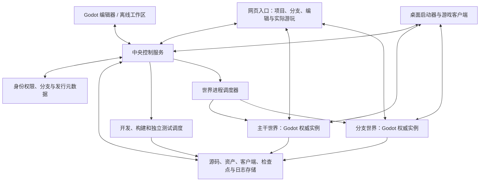

# 中央世界服务：整体架构与体验

初始设计日期：2026-09-06。实施中：以下是目标架构，已实现和已验证的范围以 [验收记录](ACCEPTANCE.md) 为准；设计描述本身不是通过证据。

## 1. 产品的核心

中央服务器管理一个可版本化的游戏工程及它的多个世界。协作者可以从任意接入端找到主干或自己的分支，编辑、构建、下载、试玩、分享，并把内容合并回主干。

玩家无需始终留在同一个客户端进程。系统同时提供三种进入新内容的方式：

| 方式 | 使用场景 | 体验约定 |
| --- | --- | --- |
| 当前世界热更新 | 兼容的模型、参数、行为等修改 | 尽量原地生效，保留游玩状态；坏候选不破坏旧版 |
| 主动跳转世界/分支 | 查看主干最新、同事分支、指定测试版本 | 后台准备目标，清楚显示将去哪里；按目标世界规则接续状态 |
| 更新客户端后接续 | 引擎、宿主或接口已不兼容当前程序 | 下载并验证匹配客户端，准备成功后交接控制权；允许新进程或新 Web 运行实例，不伪称原地热更 |

目标是减少手工重开与状态丢失，并提供可恢复的进入过程，不承诺跨引擎或跨版本永远零等待。

## 2. 中央服务器如何分工

“中央”指统一的身份、目录、持久化规则和调度入口。控制 API 不承担每个角色的逐帧物理计算；多个世界分别由 Godot 权威进程执行，进程可以在同一主机起步，以后分布到不同主机。

| 服务职责 | 管理的对象 |
| --- | --- |
| 协作者与权限 | 项目成员、分支读写、试玩/编辑/合并权限、会话与设备 |
| 分支与版本目录 | 源码提交关系、分支 head、可玩版本、构建状态、默认世界和历史记录 |
| 内容与客户端下载 | 原始资产、构建产物、各平台客户端、依赖清单、哈希、下载授权和缓存 |
| 状态存储 | 世界检查点、权威状态变化、玩家存档域、迁移记录与持久化水位 |
| 工作调度 | Codex 工作区、Blender 构建、目标导出、独立测试、依赖与失败重试 |
| 世界调度 | 创建/唤醒/休眠世界、运行版本、权威租约、容量限额、故障恢复 |

Godot 支持 headless 与专用服务器导出，这为世界权威进程提供基础；分支、存储、调度和恢复协议需要本工程实现。[Godot 专用服务器说明](https://docs.godotengine.org/en/4.6/tutorials/export/exporting_for_dedicated_servers.html)

## 3. “主干最新状态”必须说清楚

界面可以提供一个“进入主干最新”的按钮，内部必须区分：

| 名称 | 含义 | 是否随每次编辑立即改变 |
| --- | --- | --- |
| `source_head` | 最新接收的源码提交 | 是；它可能尚未构建或测试 |
| `playable_head` | 满足该发布渠道验收要求的不可变可玩版本 | 只有构建、依赖和验收就绪才推进 |
| `live_world_state` | 某世界实际使用的版本、权威代次和当前进度 | 随该世界游玩或内容应用而改变 |

每个分支可以有多个世界，例如共享开发世界、个人验证世界、冻结的复现世界。因此分支本身没有唯一一份“所有人的当前进度”；需要登记默认世界，并让入口明确选择“加入正在运行的世界”还是“从检查点创建我的试玩副本”。

默认“进入最新”解析为指定渠道的最新可玩版本。如果最新源码还在构建，显示该事实，并明确当前进入的是哪个可玩提交。不得把源码 head、任意客户端最新版与另一个房间的旧存档随意组合。

如果默认世界仍停留在旧版本，中央服务需安排兼容更新，或从可迁移状态准备一个匹配的新世界；准备完成前不能标成“最新已经可进入”。用户也可以明确进入仍在运行的旧版本。

## 4. 协作者的完整流程

### 在线编辑与查看同事成果

打开项目后，入口显示主干、个人分支、最近可玩版本、构建/测试情况和可进入的世界。点击一个分支即可查看改动、下载内容或进入其游戏世界。

游戏内选中对象时显示青色描边和包围提示；属于该世界/分支的开发任务显示橙黄维护圈与黄黑施工标识。任务状态必须带分支和目标对象身份，不能让另一个实验分支的施工标记污染主干现场。

网页编辑器可以修改受支持的场景结构和参数；Godot 原生编辑器可以进行完整内容创作。两种编辑入口都记录基础提交，先落到工作区或分支，经构建验收后才成为可玩版本。普通已授权编辑按项目规则自动推进，不为每次保存增加确认弹窗。

### 离线制作

协作者选择分支和基础版本，下载可离线使用的编辑包、资产依赖、运行客户端与经过授权的状态种子。本地修改和试玩保存在独立工作区，即使中央服务暂时不可达也不会丢掉未提交内容。

重新联网后上传差异及其基础版本。服务端做三方合并、构建与验收；有冲突保留工作区并给出冲突对象。离线试玩的怪物生命、任务完成和背包是另一份运行历史，可保存为检查点供复现，不自动合并进主干游玩事实。

### 获取主干或分支的最新客户端并跳转

1. 选择目标分支以及“加入共享世界 / 创建个人试玩 / 固定版本复现”。
2. 服务端解析一次固定的发行清单，客户端按哈希下载缺少的程序和内容；原会话或本地草稿保持可用。
3. 目标运行实例启动并校验版本，取得对应状态基线；在线世界继续补齐下载期间产生的状态变化。
4. 目标达到可接管状态后，中央服务完成旧控制权撤销与新控制权授予，切换输入与显示。
5. 玩家进入目标世界。提交交接前失败则继续旧会话；交接后故障依据服务端记录重试或发起反向交接。

原生启动器负责选择和启动匹配的程序；Web 外层入口负责下载并装载固定版本的游戏运行实例。浏览器没有权限静默安装桌面程序，所以网页真实游玩默认使用 Web 游戏产物，桌面安装或打开通过已有启动器/用户系统流程完成。

## 5. 世界与角色状态怎样继承

| 场景 | 默认状态规则 |
| --- | --- |
| 同世界断线重连 | 同一账号重新验证，取得权威世界最新状态与新的控制代次 |
| 同世界升级客户端 | 世界不回滚；客户端同步后接续该角色当前有效状态 |
| 在主干创建实验分支 | 内容从指定提交分叉，世界从指定检查点或声明的初始状态创建，记录来源 |
| 去同事分支试玩 | 保留账号和界面偏好，使用目标世界对应角色/存档；不自动把原世界背包带进去 |
| 回到原来的世界 | 恢复原世界此刻的权威状态；其他玩家期间产生的变化仍有效 |
| 离线试玩上传 | 保存为独立状态分支/检查点；导入共享世界需要明确规则、权限和验证 |
| 源码分支合并主干 | 合并内容与迁移方案，重新构建测试；不合并所有实验世界的运行历史 |

跨版本保留位置需检查目标场景、出生锚点和碰撞；原坐标已变成墙内时使用声明的安全位置。检查点保存可恢复的领域状态，Node/RID/GPU 句柄和任意协程栈不作为跨进程存档格式。

## 6. 存储与发布

初期按职责选用源码版本库、事务型元数据存储、按哈希组织的文件/对象存储和持久化任务队列；部署供应商不在此轮锁定。大资产、客户端包和世界检查点不作为普通数据库大字段。

源码 ref、可玩指针与世界有效版本各有唯一写入入口。Git 存放源码历史，元数据服务管理可玩发布与会话；跨存储操作先确保不可变对象完整，再推进可见指针，通过持久化事件/重试完成索引同步。不能把部分上传的目录公开为可玩版本。

构建产物必须关联源码、依赖锁、工具链、平台、引擎版本、宿主接口、协议、状态 schema 和测试证据。主干可配置发布渠道所需的目标集合；平台未验收就显示不可用，不静默退到不同内容版本。

构建完成顺序不等于发布顺序。可玩指针通过发布意图代次、源码关系和条件更新防止旧任务晚完成时倒退主干；旧产物仍可作为固定历史版本使用。世界升级还需核验已连接客户端的实际应用结果，未同步的旧版本端暂时不能操作新规则世界。

按哈希复用资产，按活动世界、有效下载、可玩版本及保留的检查点追踪引用。删除分支不立刻删除仍被世界或协作者使用的文件；休眠世界保留检查点，按需唤醒。建立容量、过期策略和真实恢复测试，不能只宣称“都有备份”。

## 7. 热更新在新方案中的位置

热更新是中央服务管理的一种交付能力。发行兼容当前宿主且状态迁移可验证时，在当前世界局部应用；需要新的客户端或权威程序时，准备新运行实例并迁移；用户主动选择另一个分支时，执行明确的世界跳转。

此前 Godot 源码发现仍有效：运行时能加载脚本和 GLB，但缓存、静态初始化、生命周期、物理队列和错误传播不会自动组成安全事务。Logger 只能记录已经产生的错误；debug/release 构建必须分别验收。详见 [引擎研究记录](../research/godot/4.6-stable/README.md)。

这让原生引擎或宿主升级不必伪装成“任意代码原地替换”。代价是需要实现客户端下载、状态兼容、交接、旧版本保留和故障恢复；新进程启动可能有过渡时间，必须真实展示。

## 8. 网页是实际玩法入口

Portal 提供分支目录、协作、编辑和验证界面，也装载该版本对应的 Godot Web 运行产物，连接同一中央世界服务。Three.js 可以辅助轻量编辑/资产查看，不能代替真实玩法客户端。

Godot Web 需要相应浏览器能力与导出配置，桌面二进制不能直接在页面里运行。若某分支使用尚不支持 Web 的能力，明确列出该目标不可用并保留桌面入口；不能显示假游戏体验。[Godot Web 导出说明](https://docs.godotengine.org/en/4.6/tutorials/export/exporting_for_web.html)

Web 版本化地址及缓存要绑定同一个发行清单，避免旧加载器混用新 WASM/内容。网页同步、音频、输入、后台恢复与状态接续均要在真实导出中测试。

## 9. 从零开始的实现顺序

| 阶段 | 具体交付 | 关键验收 |
| --- | --- | --- |
| 1. 中央目录与版本协议 | 项目、成员、主干/分支、固定发行清单、产物上传下载 | 下载期间 head 改变仍获得自洽版本；权限与失败状态真实 |
| 2. 一个世界的保存与进入 | 最小 Godot 游戏、权威世界、检查点、桌面客户端下载/启动 | 从另一个客户端恢复对应状态，角色无双重控制；独立导出验收 |
| 3. 分支与离线闭环 | 下载编辑包、离线修改、上传差异、三方合并、私人试玩世界 | 内容冲突不丢修改，离线进度不覆盖主干；主干/分支可互相跳转 |
| 4. Web 真实游玩 | 同发行版本的 Web 产物、网页进入和状态同步 | 网页实际执行交互，与对应权威世界一致，版本不可用时明确显示 |
| 5. 持续协作开发 | Codex/资产/测试调度、模块热更新、多人、保留与恢复策略 | 旧代次拒写、故障恢复、长会话性能和资源配额 |

从阶段 1 就为所有目标端定义同一协议；阶段划分只安排实现与验证顺序。首个完整产品路径是“主干发布 → 外部端取得客户端与状态 → 实际进入 → 离线分支修改 → 上传验证 → 跳转试玩”。
