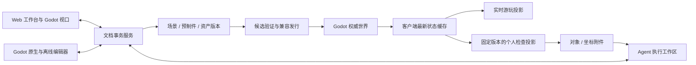

# 协作创作协议与实现边界

> 2026-09-08 用户纠正：编辑器内 Play 改为每个窗口独立的一局；暂停只暂停该局，默认隐藏游戏 UI、保留自由相机，并提供 UI 显隐与重新开始。共享创作仍同步源稿。本文中的中央世界实时加入/检查协议仅适用于明确加入共享世界，不再是编辑器 Play 的默认行为。当前实现与新证据见 [预览模式](PREVIEW-MODES.md)。

> 2026-09-08 最新纠正：保留 `/goal` 原生持续目标；移除会话顶部“目标与自动检查”验证面板及自动技术检查、独立检查 Agent 调度。Agent 修改直接保存并应用，不等待平台验收；Agent 自行决定是否测试。真实执行错误及权限请求继续进入 Inbox。见 [会话验证流程移除](AUTOMATIC-VERIFICATION-INBOX.md)。


日期：2026-09-07。**本文件是待实现契约**，不能当作当前端点说明。当前代码接口仍见 [IMPLEMENTATION.md](../packages/contracts/IMPLEMENTATION.md)。本设计覆盖用户已确认的当前 Web 视口 Play、个人检查暂停、多分支对等编辑、长期 Agent session 与空间附件。

## 1. 三种权威与两条消息流

中央 Node 服务维护创作文档及操作序列；Godot 权威实例维护在线模拟及世界序列；个人检查快照只是一份观察证据，没有世界写权限。



新增文档编辑通道，不复用现有 `/play` 的角色移动命令。`document_sequence` 与 `world_sequence` 不可互换。编辑操作确认表示文档已持久化；构建成功表示候选可运行；权威 ACK 表示世界已应用；客户端资源/场景就绪表示端上已构造。GPU 实际显示与目标玩法正确还要另验。

## 2. 原生资源与变换（2026-09-09）

当前升级采用 `creation-native-1`。Branch head 指向不可变源版本，`source_files` 保存完整 Godot 工程每个路径的字节哈希和大小，`source_identity` 固定整个工程。`.tscn/.scn`、`.tres/.res`、脚本、原始资产和导入设置是内容事实；`resources/native_nodes` 是同一版本经真实 Godot 生成的只读查询索引。旧 `creation-flat-1` / `creation-hierarchy-2` 继续用于读取历史，不再作为新原生编辑的场景权威。

`.atelier/catalog.json` 只增加资源名称、场景/预制件分类、描述、属性绑定和知识。导入普通 Godot 工程时自动发现全部场景，包括未实例化的定义；`project.godot` 的有效运行主场景决定默认入口。网页不认识的节点、资源、动画和信号不被转换成受限组件列表。

迁移目录中的 `archived_scene_paths` 只标记未被当前资源引用的历史场景，完整字节继续归档但不重复加入工作台目录。仍被当前实例依赖的旧定义登记为有明确名称的兼容预制件，保持可发现、可打开和真实引用关系。

- Godot 的 PackedScene、SceneState 和 ResourceSaver 负责实例继承、属性覆盖、资源共享与实际保存。编辑分支中的预制件路径引用随同一次源提交更新；未覆盖属性跟随定义，覆盖属性保留。修改默认值不需要逐个“升级实例”。
- 发布、导出、Agent 环境和每局 Play 固定完整工程版本。旧发行或运行中的游戏不会因为源稿推进而自行换版。
- 定义节点使用 `metadata/wa_node_id`，实例使用 `metadata/wa_instance_id`。对象地址包含项目、分支、资源、完整 `instance_ids` 和定义 node ID；仅靠名称或 NodePath 不能跨版本重绑。查询中的 `native_path` 只用于定位该固定场景里的真实节点。
- 原生 `Transform3D/Transform2D` 保留其引擎表示。完整世界矩阵操作可以保留剪切，不依赖旧框架的正缩放 TRS 限制。需要逆矩阵的操作拒绝不可逆或非有限输入。Node2D 使用二维局部变换；Control 布局通过原生 `control_layout` 原子操作编辑，包含锚点、偏移、尺寸、旋转中心及容器布局参数；Container 管理的几何只读。恢复默认解除原生覆盖，详见 [Control 布局](NATIVE-CONTROL-LAYOUT.md)。
- 普通属性采用属性版本前置条件；空间/结构操作固定资源版本和目标地址。属性恢复调用引擎移除真实覆盖。删除预制件内部结构可能使其他实例覆盖失效时，中央事务拒绝并返回具体对象，不能静默丢弃。
- 小型原生文件修改使用路径及 `expected_hash`；完整离线工程提交比较固定环境与本地副本，保留未知字节，并在冲突时留下本地修改供合并。

原生编辑视口读取隔离烘焙的静态 Godot 场景，显示前移除作者节点脚本并保留实际模型/资源。这个显示缓存可以展平实例，仅用于查看，不回写源稿。Play 直接加载固定原生 PackedScene，执行正常 Godot 生命周期。源稿、编辑缓存和游戏状态分别具有明确的身份。实施进度与证据见 [原生框架升级](NATIVE-FRAMEWORK-UPGRADE.md)。

`GET/POST /creation-api/projects/:p/branches/:b/game-releases` 管理独立游戏试玩发行。拥有者或编辑者显式发布已完成的统一 Web 构建，输入固定 `build_id/source_revision/entry_scene_id`、幂等请求 ID 和当前 `expected_pointer_version`；历史发行不可变，当前指针独立更新。`playable-game` 解析当前发行，`play-build` 为公共玩家返回该准确构建。默认入口取最近一次显式发布，未发布的源默认入口变更不改玩家入口。共享世界发行使用独立的 `native_shared` 构建目的和权威协议，不混入独立游戏发布。`shared-world` 查询运行/发布状态，`shared-playable` 解析已应用的固定客户端；`publish` 固定 source revision 与 expected world version。客户端加载真实场景并确认基线后才授控制。详见 [原生共享世界](NATIVE-SHARED-WORLDS.md)。

## 3. 共享编辑事务

拟定接口：

| 接口 | 作用 |
| --- | --- |
| `GET /api/projects/:p/branches/:b/resources` | 全部场景、预制件和资产目录，包含未实例化的定义 |
| `POST .../resources` | 创建空场景、预制件或锚点所在资源 |
| `GET /api/resources/:id/revisions/:rev` | 读取不可变资源，按项目成员权限校验 |
| `POST /api/documents/:id/transactions` | 手动、Agent、原生编辑器统一提交原子操作 |
| `WS /edit` | 订阅分支/文档快照、顺序增量、presence 和临时拖动预览 |
| `POST /api/projects/:p/branches/:b/merge-preview` | 固定源/目标/base 三个版本并生成差异 |
| `POST .../merge` | 使用固定预览与已选冲突结果提交，目标已变时重新计算 |

事务包含 `transaction_id, actor_id, client_id, project_id, branch_id, resource_id, base_revision, expected_target_versions, ops, origin`。origin 是 manual 或固定 `session_id + goal_id + cycle_id + agent_run_id + lease_generation`。Agent 提交时服务器核对该目标当前周期、有效运行、租约代次、取消状态和分支权限；cancel/retry 后旧 worker 的晚提交被拒绝。同一个 ID 重试返回同一结果；相同 ID 不同 payload 拒绝。

操作至少包括 create/delete node、set transform、set component field、instantiate prefab、update instance dependency、reparent。集合修改按稳定 ID，变换按整组原子 TRS 处理。不同对象可并行提交；同一变换不自动把 A 的 X 与 B 的 Y 拼成一个无人确认的结果。

世界坐标拖动还需 `expected_ancestry_hash`：服务器按完整祖先链的层级关系和变换版本计算，连同 resolved parent world transform 校验。仅检查直接父节点局部版本不足以发现祖父移动。父链任何结构/变换变化时重新换算或报告冲突，不能复用旧逆矩阵。

服务器在权限、基线、目标版本、schema 和依赖校验后，原子写资源版本、branch head、事务日志和递增文档序列，再广播确认。拖动中只发带过期时间的预览与短租约；结束提交一次事务。断线/崩溃使预览和租约过期，不持久化成半次变换。租约是减少碰撞的交互能力，不替代最终版本比较。

`document_sequence` 的作用域固定为 `(project_id, branch_id, resource_id)`；相同 resource_id 在两个分支中是不同订阅。首次订阅原子衔接基线 S 与 S 之后的增量，不能在读取和订阅间丢操作。所有包携带作用域与 `subscription_generation`；切分支/重开资源后丢弃旧代次晚包。重连通过最后确认序列补齐，日志缺口返回新的完整基线。撤销生成带前置条件的逆事务，不能覆盖同伴后来改动。非法操作、部分失败、重复投递和乱序客户端均不得形成半份文档。

一次 Agent ChangeSet 涉及多个场景、预制件或依赖时，先上传不可变候选，再原子比较并移动整个 manifest head；不能按单资源依次公开半套依赖。受影响文档广播同一个提交 ID，客户端在依赖齐备时切换。

文档与 source head 的一个事实必须一致：不要同时让 Web 的操作日志和旧整份 JSON commit 各自成为最新真相。schema 1 旧工程保留在示例适配器；schema 2 分支的旧入口要拒绝或显式转换到相同事务层。

## 4. 当前 Web 视口 Play 与个人检查

工作台状态机：`editing → preparing_play → playing → entering_inspect → inspecting → resyncing → playing`。失败状态保留此前可用视图与工作台上下文，并有重试；个人检查不调用 world freeze/sleep，也不创建替代 world。

Play 固定 `source_revision + resource_manifest + runtime_manifest`，等待对应可玩候选后进入。共享世界可继续运行旧兼容发行，显式发布/自动经过门禁的兼容更新决定何时应用；不能把每次拖动同步等同于在线游戏已更新。UI 分别显示“场景已同步”和“试玩已更新”。

进入个人检查：

1. 停止发送玩法输入，提交零输入并确认或进入连接错误状态；清除按键/摇杆状态。
2. 在一个一致的客户端快照边界创建 Inspection，固定 `world_id, release_id, epoch, world_sequence, state_hash, resource_manifest, camera`。
3. 构造无权威逻辑的检查投影；相机、拾取、操作柄和编辑网络继续工作。最新世界状态继续接收进有界缓存，但不覆盖检查投影。
4. 如“暂停”点击后版本边界已经越过，记录实际固定的版本，不冒称冻结在点击的精确墙钟时刻。

检查投影固定模型/材质/逻辑参数引用，避免仅冻结位置但资源悄悄换版。它应复用可共享的只读资源、隔离可变材质/实例状态，限制保留数量；复杂世界可按可观察区域按需实例化。仅冻结 2D 纹理不能支持绕物体漫游。

检查时右侧同时知道“观察版本”与“编辑文档版本”。对动态物体的位置批注是 observation；设置初始布局是 scene transaction。若用户要把模拟姿态作为初始姿态，应明确执行“应用所见变换到场景”，带版本校验，不能作为普通点选副作用。

恢复时取当前 authority epoch、发行、控制代次与连续基线；校验并准备匹配的资源，再开放输入。旧按键、插值缓存和旧命令不重放。暂停期间发生角色死亡/重生、世界升级或权限撤销，都采用真实当前结果。不同运行时需要在当前视口内准备新 iframe/实例并交接，保留检查快照作为失败退路；这不叫同进程热重载。

## 5. Session 与精确附件

建议持久化记录（不是浏览器 localStorage 的替代命名）：

| 记录 | 核心字段 |
| --- | --- |
| CreatorSession | session_id, project_id, branch_id, owner_user_id, title, visibility, executor_thread_id?, forked_from?, created_at, archived_at? |
| Message | message_id, session_id, sequence, role, content, attachments[], run_id?, created_at |
| Goal | goal_id, session_id, objective, acceptance, status, current_cycle_id |
| AgentRun | run_id, goal_id, cycle_id, session_id, executor, worker_workspace, lease_generation, input_revision, status, events_cursor |
| ChangeSet | change_set_id, run_id, base_revision, resource_changes, dependency_closure, candidate_revision |
| Verification | verification_id, change_set_id, tested_manifest, checks, result, evidence |
| Delivery | change_set_id, release_id, world_id, epoch, applied_sequence, receipt |

每个 branch + owner 是会话集合，不是一个 singleton。登录会话的七天过期不删除创作消息。每条消息在触发执行前持久化；事件流断开通过 cursor 继续。服务重启后对执行者做状态核对，不能重跑同一次工具写入。浏览器草稿保留 target session，切分支不会重定向未发送内容。

附件示例：

```json
{
  "attachment_id": "attachment_example",
  "kind": "spatial_anchor",
  "project_id": "project_example",
  "branch_id": "branch_example",
  "scene_id": "scene_example",
  "scene_revision": "immutable_revision",
  "node_id": "anchor_example",
  "instance_path": [],
  "definition_node_id": null,
  "node_revision": "immutable_node_version",
  "space": "scene_world",
  "units": "metres",
  "basis": "right_handed_y_up",
  "world_position": [12.5, 3.0, -8.25],
  "local_transform": {"position":[12.5,3,-8.25],"rotation":[0,0,0,1],"scale":[1,1,1]},
  "parent_id": "node_root",
  "parent_revision": "immutable_parent_version",
  "ancestry_hash": "immutable_hierarchy_and_transform_fingerprint",
  "camera": {"position":[20,10,5],"rotation":[0,0,0,1]},
  "observation": null
}
```

对象附件还包含 prefab ID/版本及只读对象快照；来自试玩时 observation 固定 inspection/world/release/epoch/sequence/state_hash。引用对象删除、改名或分支切换不改写附件；读权限在创建、读取、分享、执行时均重新校验。不会把整个私人会话自动附给其他协作者。

协作 tab、维护圈和公共活动流只投影已授权场景里的对象地址、执行者公开身份、editing/testing/failed 等操作状态与可公开变更 ID。默认不投影私人目标正文、消息、附件、工具参数、错误中的路径/凭据或私有 session 链接。新 Agent 会话默认 `shared`，仅项目成员可读；创建时可显式指定 `private`，拥有者也可在设置中手动改为私有。已有会话不迁移可见性，目标可见性和对象可见性不能互相替代。

## 6. 真正的 Agent 执行

先建立可替换的执行器适配层，工具事件与产出归中央服务记录。首个本机适配可接 Codex App Server，映射本产品 session_id 到持久化 thread id；官方接口提供 thread/start、thread/resume、turn/start 和增量事件，但不负责本产品的分支授权、资产发布与目标验收。[官方接口](https://learn.chatgpt.com/docs/app-server)

执行器在明确绑定的分支工作区运行，场景工具调用事务 API；代码与 Blender 产物先落隔离候选目录，验证后由主集成流程提交。禁止把“能执行代码”理解为每个协作者的代码都直接在中央权威进程里跑。Blender 由有该能力的本地/远程 worker 执行，Web 页面不能直接启动另一台用户机器上的 Blender。

目标状态建议为 queued/running/blocked/verifying/ready/failed/cancelled/completed。blocked 保留缺失信息；ready 表示变更和验证就绪；completed 必须有对应目标的验收依据。runtime applied 单独标识现场使用的变更。执行器一条“完成了”的文本、另一个人改同对象、构建通过都不能单独推动目标完成。

不要求每次可逆的已授权编辑都弹审批，但代码运行、凭据、网络和发布权限必须继承实际执行环境的限制；UI 必须能显示真实审批/输入请求。凭据不复制到会话文本或场景文件。任务取消应中止/停止排队的执行并清理租约，已持久化变更通过新的撤销事务处理，不能回滚别人提交。

## 7. 实现改造与风险

| 现有部分 | 演进安排 | 主要风险 / 必须验证 |
| --- | --- | --- |
| 身份、版本图、哈希资产、构建/世界调度 | 保留为基础设施 | 权限范围、版本身份、原有数据和历史证据必须保留 |
| Starfall schema 1 与硬编码场景 | 降为明确示例；新增 schema 2 与公共 SceneAssembler | 不能只补 Y 字段，碰撞/拾取仍在地面 XZ |
| Portal 单页导航与对象列表 | 变为分支入口、创作工作台、真实全预制件目录 | 不以换 tab 文案冒充能力实现 |
| 整份 content HTTP commit | 新增文档事务与 edit 通道并统一写入口 | 双重真相、覆盖他人改动、断线丢操作 |
| 当前任务 hash 推进 | 改为 goal/run/change/verification/delivery 因果链 | 改名错误完成交互目标、多个任务错误同时结案 |
| 当前玩法相机与 active 输入门禁 | 分离实时玩法投影、个人检查投影、编辑输入 | 暂停网络、锁死相机、陈旧输入恢复、内存翻倍 |
| Web GLB 与受约束逻辑 | 延续候选隔离与依赖验证，新增组件生命周期 | 浏览器性能/导入差异、状态迁移、任意脚本安全边界 |
| 原生编辑器适配 | 2026-09-09 改为完整原生文件差异往返 | 未识别节点和资源保留原字节，不能再导回受限组件 JSON |

实施次序按用户旅程推进：资源/事务基础 → 同一场景两端真编辑和全预制件独立编辑 → 持久会话/真实 Agent 产出与附件 → 同一 Web 视口 Play 和个人检查 → 分支差异/手动合并 → 离线和复杂热更回归。每段必须接回完整主线，不能继续扩大示例战役掩盖创作功能空缺。

任意 GDScript、GDExtension、引擎版本或 Web 模块替换没有自动安全 HMR 保证。可兼容数据/资产/契约内行为走当前运行时更新；不兼容代码走候选客户端和状态迁移。缓存按不可变版本隔离，导入失败保留最后可用场景。源码依据另见 [Godot 个人检查技术说明](GODOT-INSPECTION.md)。
