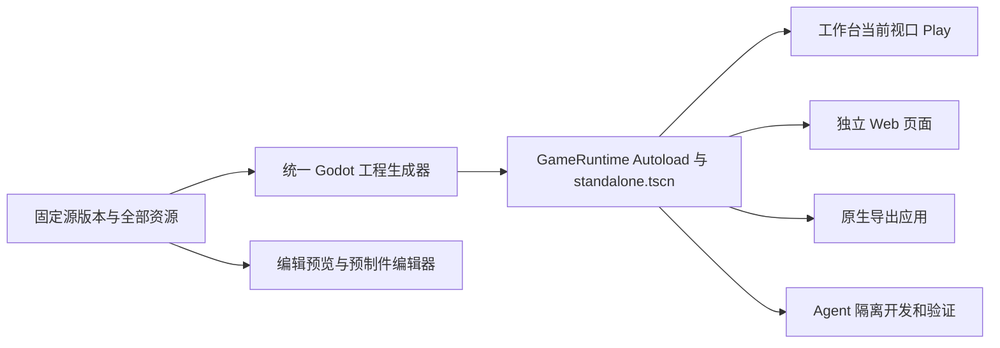

# 统一游戏工程与运行入口

2026-09-08。编辑 Play、独立 Web、原生应用和 Agent 的固定测试工程共用同一个工程生成器和 Godot 启动入口。原工作台地址、共享源稿、长期会话及历史发行继续保留。

## 工程与启动

中央 `creator_revision` 固定共享源稿。2026-09-09 的 `creation-native-1` 直接保存完整原生 Godot 文件的不可变哈希，场景继承由 Godot 解释。`services/creation/project-snapshot.mjs` 物化这些原文件，再增加统一启动配置；文件副本可通过原中央事务提交差异，不独立推进共享 head。旧 JSON schema 的装配器仅用于历史兼容。实施状态与新证据见 [原生框架升级](NATIVE-FRAMEWORK-UPGRADE.md)。

2026-09-08 默认玩法清理：通用入口不再自动加入 `local-player`，不注册 WASD / 方向键、空格、E 的玩法动作，不附带角色触屏按钮、交互提示或跟随相机。角色、控制和游戏相机由项目场景/行为显式创建；没有作者相机时仅保留静态备用视角。暂停检查的自由相机继续工作。工作台本地试玩只展示运行状态，不提供假定角色存在的通用控制面板。`world_state.runtime_ready` 确认本地游戏运行，`control_ready` 不再伪报角色控制权；模式切换对本地运行与共享世界分别检查运行就绪和真实控制权。共享世界的显式加入协议仍独立运行。

运行模板变化参与完整构建身份，下一次 Play/新页面/导出会生成新的固定工程，不复用旧控制器的产物。已打开的运行及历史导出不原地改写，需重新启动试玩或重新导出。

原生固定工程的 `project.godot` 使用 `GameRuntime="*res://atelier_runtime/standalone.gd"` 和 `run/main_scene="res://atelier_runtime/standalone.tscn"`；作者原文件与其他 Autoload 保持原路径，原 `project.godot` 字节保存在源归档。框架保留 `GameRuntime` 名称，已有同名作者 Autoload 会明确报冲突。旧 schema 固定工程仍使用根目录 standalone 路径。字体在 Autoload 的 `_enter_tree` 安装，之后加载真实作者场景。

`GameRuntime.open_scene(resource_id)` 先加载固定依赖，再通过 `SceneTree.change_scene_to_packed()` / `scene_changed` 切换真正的 `current_scene`。场景的 UI、物理节点和行为生命周期随该场景释放；字体、不可变资源缓存、运行管理和可选调试桥留在 Autoload。切换关卡从该关卡初始状态开始，跨关卡进度应由游戏自己的持久服务/显式状态模型管理，不能假设上一个 SceneTree 的节点仍存活。

模型编辑器 `main.gd`、编辑相机、网格和协作标记不进入生成游戏工程。原生编辑视口通过 `native-preview-build` 固定全部原生场景并生成移除作者脚本的静态显示缓存；Play 通过 `play-build` 执行真实场景和脚本。两个入口共用固定源，不共用一份可写运行状态。游戏宿主只维护在 `tools/release-template/`，不要在编辑宿主新增一份玩法启动逻辑。

## 两个 Web 入口

`POST /creation-api/projects/:p/branches/:b/play-build` 接收 `source_revision, entry_scene_id, request_id`，返回后台构建任务。编辑 Play 和新页面游玩都调用此接口，再用原任务查询及访问授权接口取得同一个 `/creation-releases/:build/web/index.html`。

复用由服务端决定。`content_key` / `canonical_identity` 绑定项目、分支、源版本、入口、完整运行源码、存储域、生成/适配代码及实际 Godot 程序和导出模板的哈希。排队前固定运行源码；队列执行时重新核对工具链。内容相同但运行代码已改、旧包损坏、生成器不同均重新构建。历史包保持原字节及原哈希。构建完成只表示产物就绪，不推进源码、发布指针或共享世界状态。

2026-09-09 打包复用优化：显式应用打包也可复用已有 Play/普通应用包，或加入同内容且目标齐全的进行中任务。下载复用同时核对各目标工具链、ZIP 和 Web 文件；缺平台或产物损坏会新建任务。进行中多平台任务的任一工具链已失效时，不让新请求加入。每次打包请求独立保存幂等映射，仍重新核对请求者的当前编辑权限；已加入任务的有效请求者可维持执行，全部失权则拒绝。源工程 ZIP、编辑预览和共享构建保留各自路径。文件哈希按真实路径及纳秒文件元数据作有界 LRU 缓存，文件变化后重算，不再整批清空。

嵌入页只增加 `launch=editor&wa_embedded=1&nonce=…`。实际 HTML、JS、WASM 和 PCK 与独立页面相同。调试桥同时核对同源、父窗口、nonce、固定源版本、运行身份和场景代次。`ready` 表示引导就绪；宿主发送本局身份后，真正的 `loaded` 和 `world_state` 才确认游戏开始。加载中停止、切文档及重新开始都会拒绝旧异步结果。

冷启动的下载、WASM 编译与场景初始化由游戏传输层单独限制为 180 秒；45 秒的模式确认计时只在收到实际 `loaded` 后、且仍待模式回执时开始。较慢主机不会在仍初始化游戏时消耗模式切换时限，加载期间仍可随时停止。

运行过程中换关卡会更新所见对象与相机的源文档身份；A → B → A 也重新绑定相应固定文档。编辑标签页仍保留原目标，停止后恢复原编辑相机。暂停时固定到 Agent 会话的对象来自实际关卡的固定源版本，不把本地运行位置写成中央源布局。

## 存储与权限

| 数据 | 所有者与规则 |
| --- | --- |
| 源稿、预制件版本、会话和附件 | 原中央创作数据库及资产仓库；本次不重写历史记录 |
| 编辑 Play 内存与 `user://` | 每 iframe 独立；在 Engine 初始化前设置 `persistentPaths=[]`，停止或重开不继承试玩存档 |
| 独立 Web / 原生 `user://` | Godot 持久化域；稳定记录项目/分支的存储身份 |
| 旧导出存档域 | 保留已有项目名称对应的域；项目改显示名称不会迁移存档位置；旧的多个域只记录，不猜测或合并存档 |
| 构建与 Agent 固定工程 | 持久化清单及哈希，备份包含已登记工程输入、原生包、Web 文件和固定环境 |

旧分支如果原来共用一个项目名称存档域，这一历史关系保留；本次不声称自动识别任意游戏的存档格式。可变 Agent 工作目录与临时日志仍按会话工作区规则维护，固定工程备份不等同于任意进行中文件的原子备份。

owner/editor 可固定分支可达源版本；原生分支的 viewer 也可独立运行自己可读取的源稿。公共 player 通过 `/playable-game` 解析显式发布的原生固定构建，再由 `play-build` 返回同一构建，不因新源提交或工具链变化重新打包该发行。发布操作独立于构建完成和共享世界发布；历史旧共享发行保持兼容入口。只读试玩不会授予源码导出、原生包下载、发布、编辑或 Agent 执行权限。构建去重保留各请求者，执行、访问授权和每次取文件均重查权限。一个请求者失去权限不会覆盖另一个仍有效请求者；没有有效请求者则不能继续执行。

## 预制件、工程维护与 Agent

生成器保留全部场景、未摆放预制件、嵌套实例、迁移时保留的历史定义以及实际资产依赖闭包。原生实例地址由稳定节点及完整实例链定位，属性覆盖由 Godot 解释；不能在导出阶段另按名称展开预制件。`GameRuntime.list_scenes()` / `list_prefabs()` 提供完整目录。

原生场景直接通过 PackedScene 加载，正常 Node/Resource 脚本执行 Godot 生命周期。API 1 RefCounted 行为包装只服务迁移内容，其各属性独立导出并参加真实实例覆盖。源文件往返保留网页未认识的节点、资源、动画与信号。

`workspace_prepare`、导出/打包、独立验证共用 `snapshotProjectRuntime` / `assembleProject`。Agent 新回合上下文包含工程契约、入口、资源清单与存储策略；既有会话 cwd、私人消息、当前进行中的运行及历史固定工程不被原地替换。维护步骤为：

1. 读当前源文档及版本，用 `workspace_prepare` 获取固定工程。
2. 需要本地改动或测试时复制到 `work/`，从 F5 / `--path` 进入；单资源检查使用 `-- --release-scene=<id>`。
3. 修改通过原 `asset_publish` / `world_apply` 及版本门禁提交，按需用 `game_validate` 检查固定游戏工程；Play 或导出直接消费已保存版本。直接修改本地 `release.json` 不会写回源稿。`shared_world_validate` / `world_publish` 仅用于显式共享权威世界任务，不能代替游戏入口的检查。
4. Agent 自行决定是否测试。平台不在开发结束后安排技术检查或独立检查 Agent，也不以检查结果阻止修改应用。源持久化、运行应用和 Agent 自选测试的实际结果分别记录；真实执行错误进入 Inbox。

既有 Agent 会话保留原执行线程、历史消息和 cwd；其 `world_validate` 工具作为 `game_validate` 的兼容名称接入同一游戏验证器，无需旧线程先获得新工具才能使用正确入口。共享权威检查单独使用 `shared_world_validate`，原 HTTP 世界校验及 `world_publish` 继续执行权威兼容门禁。

技术检查先确认真实请求入口的启动回执，再累计不同场景代次的实际运行 tick，允许游戏自行加载其他固定场景。报告分别记录请求入口、最终场景、代次与累计 tick。新鲜度绑定整个源清单，避免另一个关卡已变化时继续拿旧多场景工程的检查作证明。

## 暂停与范围

每个浏览器窗口启动独立的一局。暂停冻结该局场景树、模拟、行为 Tween、音频和粒子，保存 UI 原可见/输入状态，由场景树之外的调试相机提供只读观察。显示游戏 UI 仍阻止玩法交互；继续恢复实际游戏相机及原 UI。运行脚本故障保留现场供检查，继续操作说明需要重启，重新开始创建初始状态。

显式共享世界仍由中央 Godot 权威服务运行，个人观察只冻结个人呈现；本地 Play 的暂停和 `user://` 规则不会应用到共享世界。原生共享工程从相同 `project-snapshot.mjs` 固定源装配：服务器执行完整 PackedScene/作者脚本，Web 使用同一固定版本烘焙的真实静态场景接收权威状态。共享构建目的为 `native_shared`，需要显式发布，普通 Play 和独立试玩发行仍各自固定版本。旧 flat/H2 房间保留原运行端；原生索引仍不得进入旧 JSON 模拟器。兼容默认参数可在原权威进程更新，脚本/结构变化通过检查点和新 epoch 接管。状态与输入声明、迁移及客户端基线围栏见 [原生共享世界](NATIVE-SHARED-WORLDS.md)。

浏览器后台调度、音频手势和不同图形后端仍有平台差异。同一工程消除了两套业务初始化，但不承诺不同平台逐像素或逐帧完全相同。当前实际检查及证据在 `UNIFIED-GAME-VERIFICATION.md` 收录，未检查的平台不标为通过。

## 默认玩家删除的独立验证（2026-09-08）

固定运行源码 SHA-256：`b3c497dfdee0acf32bdee427322f215c23cb23aa9c7aa43df511dc10568d3f19`。

- `node --test tests/creation/unified-runtime-godot.test.mjs`：通过实际 `snapshotProjectRuntime` 工程和 `GameRuntime + standalone.tscn` 启动，原生 49 项、独立 Web 50 项实际运行断言通过。覆盖空场景无角色/碰撞体/触屏控件/默认 InputMap，WASD、方向键、空格、E 和旧控制消息无默认玩法效果，作者 F 键逻辑、相机、暂停/继续、UI、切场景、故障保留与重启。
- 同一测试导出真实 Godot Web，在实际 `GamePlay` iframe 与 `WorldModeSequence` 中记录 `playing → inspecting → playing`，无玩家控制权也能完成运行就绪，tick 冻结后继续推进。
- `node --test tests/creation/canonical-game-project.test.mjs tests/creation/unified-game-bridge.test.mjs tests/creation/preview-mode-lifecycle-workspace.test.mjs`：30 项通过，覆盖构建身份失效、真实源代码的前端模式流程和界面状态；这些是存储/前端编排检查，不计作真实玩法断言。

证据位于 `.local/creation-verification/no-default-player/native-iqu7At/`：`runtime-inputs.json`、`verification.log`、`web-verification.log`、`embedded-mode-messages.json`、`web-empty-after-keyboard.png`、`web-embedded-empty.png`。48910 健康检查通过，按 HTTP 读取的三个修改后前端模块与工作区字节一致。测试使用独立数据与临时监听端口，结束后关闭。未改写历史导出，也未把现有用户游戏或在线房间当作本次验证样本；本次未重跑全平台出包测试。
